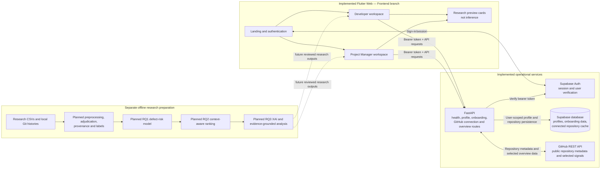

# First 50% Evaluation — System Integration Evidence

**Project:** DevInsight: An AI-Powered Software Engineering Intelligence Platform for Project Risk Prediction and Root Cause Analysis

**Evidence snapshot:** Research branch `8ae6c8ab8df1eec9d54133444031e25629854e3c`; Frontend branch tip inspected read-only at `8db334f5593b9fcd5f0ead4142ba82e4f8ea6479`.

## 1. Purpose and evidence standard

This report summarizes source-code integration evidence and previously reported validation for the first 50% evaluation. Source-code inspection establishes that relevant structures and routes exist; it does not prove a successful live deployment or manual end-to-end behavior. Test outcomes and manual checks below are attributed to the project team as user-reported because terminal logs, CI results, and demonstration screenshots were not preserved in the inspected repository.

The current working directory was on `Research`. The Developer and Project Manager frontend implementation is present on the separate `Frontend` branch and was inspected using read-only Git commands. No branch switch, merge, or application-code change was made for this report. For a live demonstration, use the team's prepared Frontend build/workspace or a known deployment and confirm its version first; do not assume the Research checkout contains the same frontend revision.

## 2. Implemented system architecture

### Flutter Web frontend

The `apps/web_dashboard` Flutter Web application contains landing, authentication, onboarding, Developer, and shared dashboard surfaces. The `Frontend` branch includes the Manager feature under `lib/features/manager/`. The current Research checkout does not represent that branch's latest frontend files, so Manager implementation status is based on the separately inspected Frontend source—not absence from Research.

### Developer workspace

The Developer workspace has a dashboard shell and destinations for Home, Projects, My Work, Issues, Pull Requests, Analytics, Code Quality, Reports, Team, AI Insights, and Settings. Repository connection and selection use the authenticated GitHub API integration. The AI Insights page explicitly presents defect prediction, issue prioritization, root-cause analysis, workload intelligence, project risk, and explainable recommendations as research directions, not operational models.

### Project Manager workspace

The Frontend branch contains a separate Manager shell and seven primary destinations: Home, Projects, Issues & Priorities, Team & Workload, Project Analytics, Reports, and Settings. The Manager Home uses the authenticated GitHub connection/overview services and retains a per-user active repository choice in browser preferences. Projects supports connecting and selecting repositories.

The Manager screens are not evidence of completed predictive research:

- Issues & Priorities displays a bounded recent GitHub issue sample and explicitly says prioritization is planned; no AI score is generated.
- Team & Workload presents observed contributor names and repository activity without interpreting them as workload, capacity, or individual performance.
- Analytics and report previews summarize available repository signals. The report page states that it does not create/download PDF or CSV files and does not present risk predictions, priority recommendations, or delivery forecasts as findings.

The Frontend branch includes `test/manager_workspace_test.dart`, with widget checks for role destinations, the seven Manager destinations, narrow navigation, and responsive shell behavior. This is source-level evidence that tests exist, not proof this task ran them or that the reported manual test was captured in a preserved log.

### Role-based navigation

On the Frontend branch, Supabase password authentication is followed by a profile lookup through `GET /api/v1/me`. The backend derives the next destination from the persisted role and onboarding state. `AuthNavigation` routes `developer_home` and `manager_home` to `AuthDestinationPage`, which selects `DeveloperHomePage` or `ManagerHomePage` respectively. This is code-verified role routing.

### Authentication and onboarding

Supabase Auth handles sign-in/session operations in the Flutter client. The API requires a bearer token and validates it through Supabase before using the authenticated user ID. The backend exposes `/api/v1/onboarding/state`, profile/preferences/notifications save routes, and `/complete`; the profile route determines the next destination.

There is a documentation discrepancy: the Frontend branch's `auth_service.dart` and onboarding page contain calls to these onboarding endpoints, while the branch's web dashboard README still says onboarding screens do not persist their form data. Confirm the behavior in the exact deployed build and update that README separately after verification. Do not rely on that README sentence as proof of current runtime behavior.

### FastAPI backend

The FastAPI application includes health, profile, onboarding, and GitHub routers. The GitHub router supports connect/list/overview/refresh/disconnect. Routes use authenticated-user dependencies and service-layer calls. The inspected route inventory does not include RQ1 prediction, RQ2 prioritization, SHAP, LLM explanation, or root-cause endpoints.

### Supabase authentication and persistence

The backend initializes Supabase clients from server configuration, verifies required tables, and authenticates bearer tokens with Supabase Auth. The connected-repository migration defines per-user repository metadata and cached summaries, a user/repository uniqueness constraint, an index, RLS for user-scoped reads, and service-role writes. The migration is applied manually in Supabase; the application does not apply it automatically. Supabase setup, database state, and production configuration were not independently inspected in this task.

### GitHub integration and overview

The backend retrieves public repository information and selected GitHub API data, then stores a cached summary per user/repository. The authenticated API exposes:

- `POST /api/v1/github/connections`
- `GET /api/v1/github/connections`
- `GET /api/v1/github/connections/{connection_id}/overview`
- `POST /api/v1/github/connections/{connection_id}/refresh`
- `DELETE /api/v1/github/connections/{connection_id}`

The overview includes repository metadata, recent commits/issues/pull requests, language composition, open issue and PR counts, recently closed issue counts, weekly activity when complete, and selected latest-commit/repository/CI signals. Recent issue activity includes labels, state, URLs, and timestamps; it is a bounded sample. A repository-level latest-commit CI state is not necessarily attributable to a specific issue. Incomplete/processing statistics may be unavailable rather than zero. Detected test files do not mean tests passed.

The Flutter Developer and Manager workspaces select an active connection and request its overview; the Manager page also persists selection for the signed-in user in browser preferences. The server persists connection metadata and cached summaries in Supabase. This is descriptive GitHub integration, not project-risk analysis.

## 3. Research integration boundaries

### Offline RQ1 preparation

The first-half RQ1 work is a separate offline research activity: ten provisional Python/Dart repositories, 30 sampled issue records, a timeline cache, and a local fixing-commit provenance audit. It is not a production training pipeline, feature matrix, or inference service. Eight of the eleven PR-reference diffs remain unavailable locally, and human adjudication is pending.

### Planned hand-offs

1. **RQ1 → RQ2:** a validated RQ1 risk estimate must be linked to relevant issues through reviewed code/issue provenance. No such model output or validated issue mapping currently exists.
2. **RQ2:** combine technical-risk evidence with explicitly supplied, traceable context (such as requirements, severity, delivery information, or verified team capacity) and evaluate against human judgments. No live priority rank exists. The current overview does not contain all those project-context fields.
3. **RQ3:** explain model/ranking behavior and retrieve traceable issue/PR/commit/code evidence. SHAP may explain model feature contributions, not causality. LLM output, if later implemented, must cite retrieved evidence and remain a hypothesis until human review. No SHAP, LLM inference, or verified root-cause analysis exists.

The operational GitHub overview is a bounded, cached, recent snapshot. The offline research pipeline concerns historical issue/fix evidence and eventual commit-level labels/features. They are distinct data flows today; offline ML is not connected to FastAPI.

## 4. System integration diagram

The implemented paths below describe source-code architecture. The planned research lane is separate and has no live inference connection to FastAPI.

Supabase Auth and database operations are shown separately because the frontend authenticates against Supabase, while FastAPI verifies bearer tokens and performs backend persistence. The diagram does not imply that offline research data or ML outputs currently flow into the API.

## 5. Evaluation evidence matrix

| Component | Implementation status | Evidence source | Verification status | Current limitation | Suggested viva explanation |
|---|---|---|---|---|---|
| Flutter Web frontend | Implemented on Frontend branch | `apps/web_dashboard/lib/`; Frontend branch tree; Developer and Manager test source | Source verified on Frontend; Flutter analysis/tests and manual review are user-reported; logs/screenshots not preserved here | Research branch is a different snapshot; actual demo deployment/version must be confirmed | “The Web UI provides separate Developer and Manager workspaces; this evidence is from the Frontend branch.” |
| Developer workspace | Implemented | Frontend `features/developer/` pages and dashboard shell | Source verified; sign-in/navigation and visual review user-reported | Descriptive dashboard; analytics/AI previews are not ML outputs | “The dashboard presents repository context and GitHub activity, not defect predictions.” |
| Project Manager workspace | Implemented on Frontend branch | Frontend `features/manager/`; seven-destination routing; `manager_workspace_test.dart` | Source and test definitions verified; manager sign-in, seven-page navigation, and sign-out user-reported | Confirm Frontend build is what will be demonstrated; issue priorities/workload are previews, not live inference | “The Manager UI summarizes repository evidence; predictive prioritization and workload analysis are future research.” |
| Role navigation | Implemented | Frontend `auth_navigation.dart`, `auth_destination_page.dart`; Research backend `me.py` | Code path verified; user-reported login checks | Depends on correct persisted profile role/onboarding state and configured auth services | “The authenticated profile selects the Developer or Project Manager workspace.” |
| Authentication/onboarding | Supabase Auth and backend routes implemented; UI integration present in Frontend source | `auth_service.dart`, `onboarding_flow_page.dart`, backend `api/dependencies.py`, `api/onboarding.py`, `api/me.py` | Source verified; live account behavior user-reported only | README conflicts with Frontend onboarding API calls; verify deployed build and persistence before claiming end-to-end onboarding | “Supabase authenticates users; the API verifies bearer tokens and returns role/onboarding state.” |
| FastAPI backend | Implemented | `backend/app/main.py`, `backend/app/api/{me,onboarding,github}.py` | Route/code structure verified; 41 pytest tests and 13 subtests passed is user-reported, not rerun here | No RQ1/RQ2/RQ3 inference endpoints; one dependency deprecation warning was previously reported | “The API currently serves identity, onboarding, and authenticated GitHub repository operations.” |
| Supabase Auth/database | Integrated in source; connected-repository migration provided | `supabase_service.py`, `profile_service.py`, `repository_service.py`, `database/migrations/20261108_connected_repositories.sql` | Configuration and schema code verified; live database state not inspected; HTTP 200 claims user-reported | Migration requires manual application; do not expose server credentials | “Auth and per-user repository persistence use Supabase; migration and environment must be prepared before the demo.” |
| GitHub integration | Implemented for public repositories | `backend/app/api/github.py`, `github_service.py`, `repository_service.py`; Flutter API service | Source verified; connection/refresh and HTTP 200 claims user-reported | Rate limits, cache freshness, bounded recent samples, and incomplete statistics; no issue-level project context | “The dashboard retrieves and caches selected live GitHub signals; results are descriptive and may be incomplete.” |
| RQ1 | Offline methodology/evidence preparation complete; prediction planned | `rq1_pretraining_verification_report.md`, RQ1 methodology/summary, `data/preflight/rq1_pretraining_verification.json` | Research counts and provenance audit verified previously; no model training | Fix mapping and historical blobs incomplete; no verified inducing labels, trained model, or live inference | “RQ1 is in research preparation; no predictive performance is claimed.” |
| RQ2 | Methodology proposed | `rq2_methodology_first_half.md`, RQ2/RQ3 summary | Documented proposal only | No ranking output; requirements/severity/deadline/impact/capacity inputs not integrated or validated | “RQ2 will test whether explicit project context improves ranking over technical risk alone.” |
| RQ3 | Methodology proposed | `rq3_methodology_first_half.md`, RQ2/RQ3 architecture | Documented proposal only | No SHAP, LLM inference, grounded explanation, or verified root-cause result | “RQ3 will support evidence-grounded human investigation; explanations are not causal proof.” |

## 6. Previously reported validation (not rerun)

The following are **user-reported previous results**, recorded here without representing them as tests run during this task:

### Backend

- 41 pytest tests passed.
- 13 subtests passed.
- One dependency deprecation warning.
- FastAPI health endpoint returned HTTP 200.
- Authenticated profile and repository overview endpoints returned HTTP 200.

### Frontend

- Flutter analysis passed.
- Flutter frontend tests passed.
- Manager workspace tests passed.
- Developer sign-in and navigation manually verified.
- Manager sign-in, seven pages, and sign-out manually verified.
- GitHub repository connection and refresh manually verified.
- Developer/Manager visual consistency manually reviewed.

**Code corroboration:** Relevant FastAPI routes and Flutter test source exist; Manager route/widget checks are present on Frontend. Source existence supports architecture claims but does not independently confirm the reported pass counts or manual observations.

**Evidence needed for formal substantiation:** Preserve terminal/CI logs showing exact commands, branch/commit, environment, test totals and warnings; retain screenshots or a dated screen recording for sign-in, role routing, repository connect/refresh, representative workspace pages, and sign-out. Do not create retrospective or synthetic evidence.

## 7. Material integration notes for the evaluation

- Confirm which Frontend commit/deployment will be used. The inspected Frontend tip is `8db334f5593b9fcd5f0ead4142ba82e4f8ea6479`; this task remained on Research.
- Confirm that the Supabase connected-repository migration has been applied to the demo project and that backend/frontend origins are configured. Never show `.env`, access tokens, or private credentials.
- Reconcile the stale onboarding statement in the web dashboard README against the API calls in Frontend source; only claim persistence if it is demonstrated against the intended deployment.
- Explain Manager Issues, Team & Workload, Analytics, Reports, Developer AI Insights, and related preview surfaces as descriptive or planned where explicitly stated.
- The repository README’s RQ1 target says defect-prone files or changes; the current RQ1 methodology frames commit-level defect-inducing prediction. Align this research target before claiming a completed RQ1-to-RQ2 hand-off.
