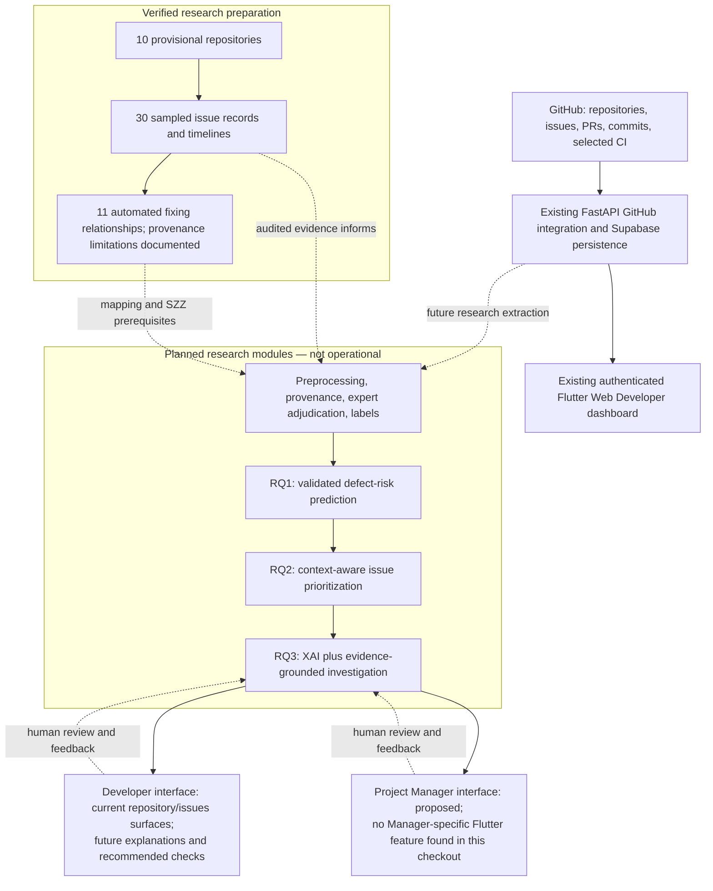
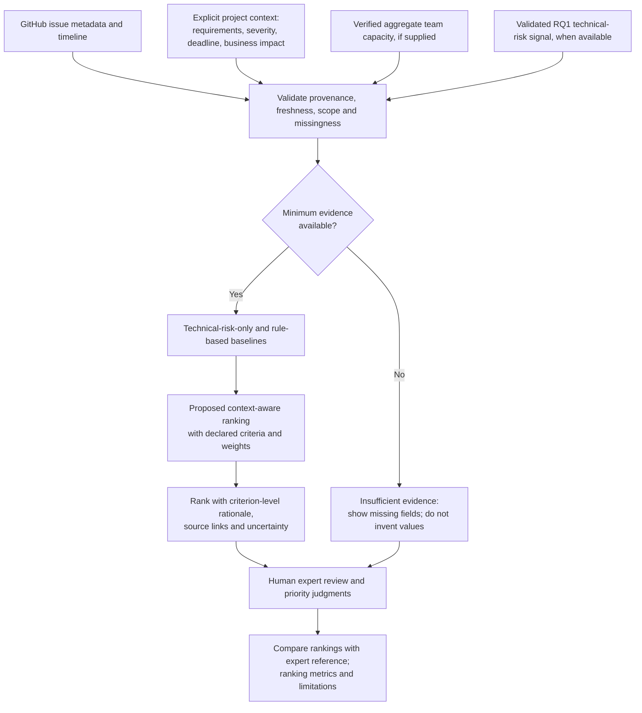
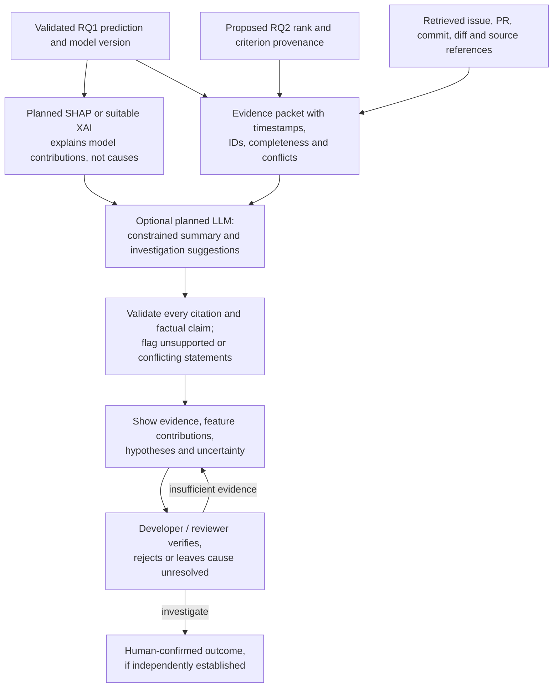
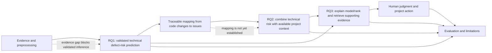

# RQ2–RQ3 Research Architecture

## Architecture status

The diagrams distinguish current infrastructure from planned research modules:

- **Implemented infrastructure:** authenticated public GitHub repository connection and cached overview services; Flutter Web Developer dashboard and repository/issue/PR views; Supabase-backed user/repository persistence.
- **Verified research preparation:** ten provisional repository histories, a 30-issue automated evidence sample, and the documented RQ1 provenance limitations.
- **Planned:** RQ1 defect-risk model and labels, RQ2 context-aware ranking, RQ3 XAI/evidence-grounded explanation and any LLM recommendation, and their evaluation.

No model inference, priority ranking, SHAP, LLM inference, or root-cause determination is currently operational. The inspected current checkout contains Developer Flutter features but no Manager-specific feature directory. A project-manager interface remains a proposed consumer of the research output.

## Diagram 1 — Proposed end-to-end research architecture

The RQ1-to-RQ2 handoff requires a validated prediction and an explicit, traceable link from the prediction unit (file/change/commit) to an issue. The current research preparation does not establish that mapping or an ML prediction. RQ2-to-RQ3 passes criterion-level ranking evidence; RQ3 does not certify causality.

## Diagram 2 — Proposed RQ2 issue prioritization workflow

All ranking and comparison components are planned. The existing GitHub service provides only selected descriptive issue and repository fields; project requirements, standardized severity, deadlines, business impact, and verified team capacity are not currently integrated.

## Diagram 3 — Proposed RQ3 evidence-grounded explanation workflow

SHAP, the LLM layer, and cause review are planned. A GitHub citation or blame result is supporting evidence, not proof of defect causation. The system must identify generated claims as hypotheses until a human confirms them.

## Diagram 4 — RQ1–RQ2–RQ3 research dependency

### Dependency gates

1. **RQ1 gate:** Resolve the target/prediction unit, adjudicate fixing provenance, acquire required historical objects through an approved method, and construct reviewed labels before training.
2. **Linkage gate:** Demonstrate how a prediction about a change/file/commit is attached to an issue; do not join records by guesswork.
3. **RQ2 gate:** Define context ownership, completeness, missing-value handling, and ranking rules before comparing priorities.
4. **RQ3 gate:** Explain only validated model/ranking outputs; retrieve traceable evidence and validate generated claims; retain human authority for causal conclusions.

## Current versus planned system inventory

| Layer | Current verified state | Planned research work |
|---|---|---|
| GitHub ingestion | Authenticated repository connections and cached summaries; selected issue/PR/commit and CI fields | Broader issue detail/timeline, historical evidence and explicit completeness/provenance |
| Research data | Ten provisional Python/Dart repositories and 30-issue sample; 11 automated fixing relationships with unresolved evidence | Expert-adjudicated labels, SZZ candidate review and versioned research dataset |
| RQ1 | No trained model or inference | Defect-risk target, feature pipeline, supervised baselines and temporal evaluation |
| RQ2 | No priority score/ranking; no supplied project requirements, standardized severity, deadline or verified capacity integration | Rule-based and context-aware rankings, evidence display and expert comparison |
| RQ3 | No SHAP computation, LLM inference, grounded explanation or verified root cause | Feature attribution, retrieval/citation validation, optional constrained generation and human evaluation |
| User interfaces | Flutter Web Developer workspace with repository, issue and PR surfaces | Research explanation components; Manager interface is proposed, but no Manager-specific Flutter source was found in this checkout |

## Proposal alignment items to resolve

- The root README is the only proposal-like research document found in the inspected workspace; no standalone official proposal file was available locally.
- Its RQ1 asks about identifying defect-prone files or changes, while the current first-half RQ1 methodology frames commit-level defect-inducing prediction. Confirm the target and prediction unit before the RQ1-to-RQ2 linkage is designed.
- The README describes a Project Manager dashboard and the web README says the Project Manager route is separate, but the inspected Flutter feature tree contains Developer, auth, landing, onboarding, and splash features only. Confirm whether the Manager UI exists elsewhere or is future scope.
- RQ2’s README mentions requirements, severity, CI/CD, workload, and delivery context. The current backend provides selected repository-level CI and GitHub activity signals, not integrated issue-level severity, requirements, deadlines, business impact, or verified team capacity.
